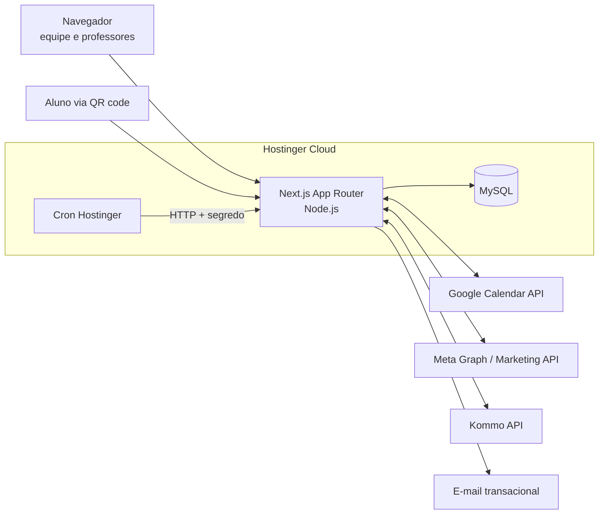

# 02 — Arquitetura

## Visão macro


Um único app Next.js monolítico e modular. Sem microsserviços: o volume da IPEMaster não justifica, e a Hostinger Cloud roda um processo Node por site.

## Estrutura de pastas
```
src/
  app/
    (auth)/            login, convite, recuperar senha
    (app)/             área logada (layout com menu e checagem de sessão)
      tarefas/ agenda/ academico/ conteudo/ dashboard/ admin/
    (publico)/         formulários públicos sem login
      presenca/[token]/
      avaliacao/[token]/
    api/
      auth/[...all]/   Better Auth
      cron/[tarefa]/   jobs disparados pelo cron
      webhooks/[origem]/ Kommo, Meta
  modulos/
    core/ tarefas/ agenda/ academico/ conteudo/ dashboard/
      servicos/        regras de negócio (única camada que fala com o Prisma)
      acoes/           Server Actions (validação Zod + permissão + chamada ao serviço)
      componentes/     UI do módulo
      esquemas/        schemas Zod compartilhados
  lib/                 prisma, auth, permissoes, auditoria, cripto, datas
  componentes/ui/      shadcn/ui
prisma/
  schema.prisma
  migrations/
  seed.ts
```

## Camadas e fluxo de uma ação
1. **UI** (Server Component para leitura, Client Component para interação).
2. **Server Action / Route Handler:** valida a entrada com Zod, chama `exigirPermissao(sessao, "modulo:acao")` e chama o serviço.
3. **Serviço:** aplica as regras de negócio, faz o acesso ao banco via Prisma e grava a auditoria.
4. Nenhum componente acessa o Prisma diretamente.

Regras:
- Leituras em Server Components chamam serviços. Nada de `fetch` para a própria API.
- Route Handlers só são usados para o que vem de fora: webhooks, cron, OAuth callbacks e formulários públicos (com rate limit).
- Módulos não importam serviços uns dos outros livremente. Dependências permitidas: todos → `core`; `agenda` → `academico`/`tarefas` (para criar eventos); `dashboard` → `academico` (cursos).

## Integrações
| Integração | Uso | Autenticação | Fase |
|---|---|---|---|
| Google Calendar | Agenda de cada usuário | OAuth 2.0 por usuário (escopo de calendário) | F3 |
| Meta Graph API | Publicar no Instagram/Facebook | OAuth da página/conta comercial | F5 |
| Meta Marketing API | Investimento, impressões, cliques, leads | Token de sistema (Business Manager) | F6 |
| Kommo API | Leads, negócios, vendas | OAuth Kommo + webhooks | F6 |
| E-mail (SMTP Hostinger) | Convites, recuperação de senha, avisos | Credenciais SMTP | F0 |

Tokens de integração ficam **criptografados no banco** (AES-256-GCM, chave em variável de ambiente).

## Jobs agendados
A Hostinger Cloud oferece cron no hPanel. Cada job é um `GET /api/cron/<tarefa>` com o header `Authorization: Bearer $CRON_SECRET`.
- `sincronizar-agenda`: renova tokens Google e sincroniza eventos vinculados.
- `importar-meta-ads` (diário) e `importar-kommo` (de hora em hora, complementando os webhooks).
- `publicar-agendados` (a cada 5 min): publica conteúdos agendados.
- `limpeza-lgpd` (semanal): anonimiza dados que passaram do prazo de retenção.

Os jobs precisam ser **idempotentes**: rodar duas vezes não pode duplicar dados.

## Ambientes e deploy
| Ambiente | Branch | Endereço | Banco |
|---|---|---|---|
| Local | qualquer | `localhost:3000` | MySQL local (Docker) |
| Homologação | `teste` | `teste.plataformaipemaster.com.br` | `ipemaster_teste` |
| Produção | `main` | `plataformaipemaster.com.br` | `ipemaster_prod` |

- São dois sites Node.js na Hostinger Cloud, cada um ligado a uma branch do repositório GitHub, com deploy automático no push.
- Comando de build na Hostinger: `npm run build` (= `next build --webpack`, ver ADR 0002). Quando o Prisma entrar (F0), passa a ser `prisma migrate deploy && next build --webpack`, e as migrations rodam antes de cada deploy.
- Fluxo: feature branch → PR para `teste` → validação em homologação → PR `teste` → `main`.
- O banco de homologação **nunca** usa cópia de dados reais de alunos. Usa o seed.

## Variáveis de ambiente
`DATABASE_URL`, `BETTER_AUTH_SECRET`, `BETTER_AUTH_URL`, `CHAVE_CRIPTOGRAFIA`, `HMAC_CPF_SEGREDO`, `CRON_SECRET`, `SMTP_*`, `GOOGLE_CLIENT_ID`, `GOOGLE_CLIENT_SECRET`, `META_*`, `KOMMO_*`, `TURNSTILE_*`.
Ficam no painel da Hostinger e nunca no repositório. O `.env.example` documenta todas.

## Arquivos e anexos
Arquivos enviados (anexos de tarefas, mídias de conteúdo) **não** ficam na pasta do app, que pode ser recriada a cada deploy. Use um storage compatível com S3, por exemplo Cloudflare R2 ou Hostinger Object Storage. Decisão pendente: ADR a escrever antes da F1.

## Observabilidade
- Logs estruturados (JSON) sem dados pessoais.
- Página `/admin/saude` com status do banco, dos jobs e das integrações.
- Erros capturados por um serviço de monitoramento (ex.: Sentry), com dados pessoais removidos.
