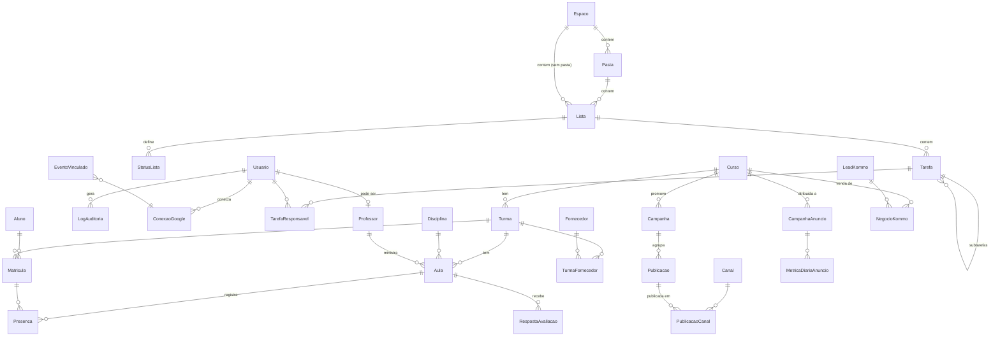

# 03 — Modelo de dados

Visão geral das entidades e de como os módulos se relacionam. Os campos detalhados de cada entidade estão no doc do módulo (`docs/modulos/`).

## Convenções
- **Banco:** MySQL 8 (Hostinger), charset `utf8mb4`, collation `utf8mb4_0900_ai_ci`.
- **Prisma:** model em `PascalCase` singular (`Aluno`) mapeado para tabela `snake_case` plural (`@@map("alunos")`). Campos em `camelCase` mapeados para `snake_case` (`@map`).
- **IDs:** `String @id @default(cuid())`.
- **Auditoria de linha:** todo model tem `criadoEm` e `atualizadoEm`. Os de negócio também têm `criadoPorId`.
- **Exclusão lógica:** `excluidoEm DateTime?` em entidades de negócio. As consultas padrão filtram `excluidoEm = null`. Exclusão física só acontece em anonimização LGPD ou em tabelas técnicas.
- **Enums:** valores em minúsculo e sem acento (`em_andamento`).
- **Dinheiro:** `Decimal(12,2)` em reais. Nunca usar `Float`.
- **Datas:** `DateTime` em UTC.
- **Dados pessoais sensíveis** (CPF): ver `04-seguranca-permissoes.md`. Ficam guardados criptografados e com um hash para busca.
- **Migrations:** sempre via `prisma migrate dev --name <descricao_curta>`. Migrations já aplicadas em `teste`/`main` nunca são editadas: crie uma nova.

## Mapa de entidades por módulo
| Módulo | Entidades |
|---|---|
| Core | `Usuario`, `Sessao`, `Conta`, `Verificacao`, `Convite`, `LogAuditoria`, `SolicitacaoTitular` |
| Tarefas | `Espaco`, `Pasta`, `Lista`, `StatusLista`, `Tarefa`, `TarefaResponsavel`, `ItemChecklist`, `Etiqueta`, `TarefaEtiqueta`, `Comentario`, `Anexo` |
| Agenda | `ConexaoGoogle`, `CalendarioConectado`, `EventoVinculado` |
| Acadêmico | `Curso`, `Turma`, `Disciplina`, `Aula`, `Professor`, `Aluno`, `Matricula`, `Presenca`, `Fornecedor`, `TurmaFornecedor`, `ModeloAvaliacao`, `PerguntaAvaliacao`, `RespostaAvaliacao` |
| Conteúdo | `Canal`, `Campanha`, `Publicacao`, `PublicacaoCanal`, `MidiaPublicacao` |
| Dashboard | `ContaAnuncio`, `CampanhaAnuncio`, `MetricaDiariaAnuncio`, `LeadKommo`, `NegocioKommo`, `Meta`, `ExecucaoImportacao` |

## Diagrama (relações principais)

## Vínculos entre módulos
- **Tarefa ↔ outras entidades:** `Tarefa` tem `turmaId?` e `publicacaoId?` opcionais. Assim uma tarefa pode pertencer a uma turma ou a uma publicação sem acoplamento polimórfico.
- **Agenda ↔ entidades:** `EventoVinculado` guarda `tipoOrigem` (`aula` | `tarefa` | `publicacao`), `origemId` e `googleEventId`. Isso evita colunas Google nas tabelas de outros módulos.
- **Professor ↔ Usuario:** `Professor.usuarioId?` é opcional. Um professor pode ser cadastrado antes de receber acesso.
- **Dashboard ↔ Curso:** campanhas de anúncio e negócios do Kommo são atribuídos a um `Curso` por mapeamento manual ou por regra de nome (ver `modulos/dashboard.md`).

## Seed
`prisma/seed.ts` cria um admin de desenvolvimento, papéis de exemplo, um espaço de tarefas e uma turma fictícia com alunos **fictícios**. Nunca usar dados reais no seed.
